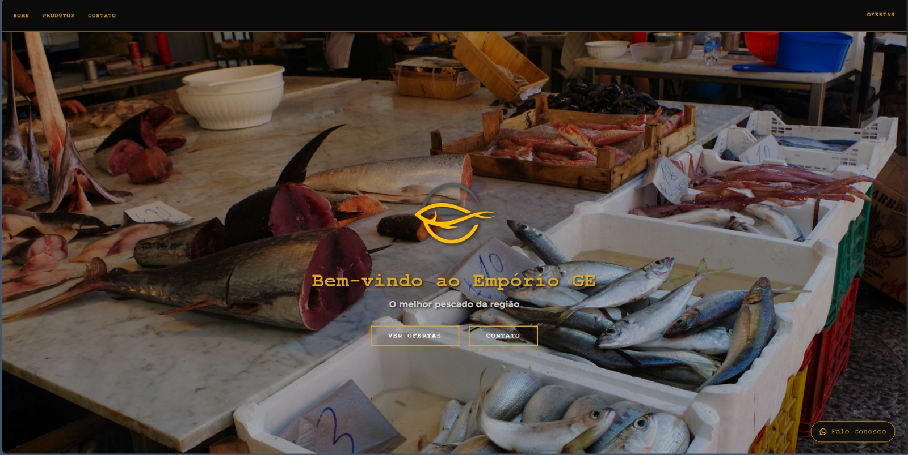

<div align="center">
  
  
  # 🐟 Empório GE
  
  **O melhor pescado da região, agora a um clique de distância.**
  
  []()
  []()
  []()
  []()
  
  *Uma plataforma moderna de e-commerce para a peixaria Empório GE, focada em UX, acessibilidade e integração direta com WhatsApp.*
</div>

---

## 📑 Índice
- [Prévia do Site](#-prévia-do-site)
- [Sobre o Projeto](#-sobre-o-projeto)
- [Funcionalidades](#-funcionalidades)
- [UI/UX e Design System](#-uiux-e-design-system)
- [Como rodar o projeto localmente](#️-como-rodar-o-projeto-localmente)
- [Estrutura de Pastas](#-estrutura-de-pastas)
- [Roadmap (Próximos Passos)](#-roadmap-próximos-passos)
- [Contribuidores](#-agradecimentos-e-contribuidores)
- [Licença](#-licença)

---

## 📸 Prévia do Site

<div align="center">
  
</div>

---

## 🚀 Sobre o Projeto

O **Empório GE** é um site institucional e de vendas desenvolvido para modernizar a experiência de compra de pescados e frutos do mar. O grande diferencial é o sistema de carrinho de compras nativo (construído do zero com Vanilla JavaScript), que permite aos clientes navegar, adicionar produtos e finalizar o pedido diretamente no WhatsApp da loja.

O design foi inspirado em referências de restaurantes premium, adotando um tema escuro (*Dark Mode*) com detalhes em dourado (`goldenrod`), utilizando a tipografia **Montserrat** para uma leitura limpa e sofisticada. O projeto foi feito sem a necessidade de frameworks pesados, provando que a base da web (HTML, CSS e JS puro) ainda é extremamente poderosa.

## ✨ Funcionalidades

- **🛍️ Navegação e Catálogo:**
- Página inicial dinâmica: slider de destaque, ofertas e catálogo interativo.
- Busca de produtos: filtro em tempo real para facilitar a localização dos itens.
- Páginas individuais: apresentação detalhada dos produtos, com galeria de imagens, miniaturas e informações sobre os cortes disponíveis.

- **🛒 Carrinho de Compras:**
- Persistência de dados: utilização do localStorage para manter os itens do carrinho durante a navegação entre páginas.
- Carrinho flutuante: visualização rápida dos itens, com prévia lateral interativa e contador atualizado em tempo real.
- Revisão do pedido: página dedicada para conferir os produtos, as quantidades, os subtotais e o valor total.

- **📲 Finalização e Responsividade:**
- Checkout via WhatsApp: geração de uma mensagem organizada com os produtos, as quantidades e os valores do pedido.
- Layout responsivo: interface adaptável para computadores, tablets e celulares.
- Menu mobile: navegação com menu hambúrguer personalizado.
- Acessibilidade: recursos para tornar a navegação mais clara e intuitiva.

## 🎨 UI/UX e Design System

- **Paleta de Cores:** Fundo escuro (quase preto) para destacar os produtos, com detalhes em Dourado (`Goldenrod`) que transmitem sofisticação e luxo.
- **Tipografia:** Contraste entre a fonte *Montserrat* (para títulos e textos) e *Courier New* (para preços), criando hierarquia visual.
- **Micro-interações:** Efeitos de hover suave nos cards de produtos, transições ao trocar imagens na galeria e animações no botão do carrinho.
- **Acessibilidade:** Uso de tags semânticas HTML5, atributos `aria-label` em botões de ícone e contraste de cores pensado para leitura confortável.

---

## 🛠️ Como rodar o projeto localmente

O projeto é construído apenas com tecnologias front-end nativas, sem a necessidade de *build steps* (Webpack, Vite, etc.).

1. **Clone o repositório:**
   ```bash
   git clone https://github.com/restudeetegec-cell/Emporio_GE.git

2. **Acesse a pasta do projeto:**
    ```bash
    cd Emporio_GE

3. **Inicie um servidor local:**
    ```bash
    python -m http.server 5500

## 📁 Estrutura de Pastas

A estrutura principal do projeto está organizada da seguinte forma:

- Emporio_GE/
- ├── images/                  # Imagens dos produtos, logo e backgrounds
- ├── js/                      # Scripts e funcionalidades JavaScript
- │   ├── carrinho.js          # Gerenciamento do carrinho e localStorage
- │   ├── header.js            # Menu mobile e recursos de acessibilidade
- │   ├── hero.js              # Slider automático da página inicial
- │   ├── product.js           # Galeria de produtos e ações do carrinho
- │   └── script.js            # Catálogo, busca e carrossel de ofertas
- ├── page products/           # Páginas HTML individuais dos produtos
- ├── style/                   # Arquivos de estilização CSS
- │   ├── main.css             # Estilos globais, variáveis e catálogo
- │   ├── header.css           # Estilos da navegação
- │   ├── cart.css             # Carrinho e prévia lateral
- │   └── productStyle.css     # Estilos das páginas de produto
- ├── index.html               # Página inicial
- ├── carrinho.html            # Página do carrinho e finalização do pedido
- └── README.md                # Documentação do projeto

 ## 🗺️ Roadmap (Próximos Passos)

O front-end já conta com as principais funcionalidades de navegação, catálogo e carrinho. As próximas etapas estão voltadas à expansão e à administração da plataforma.

 **✅ Funcionalidades Concluídas**

-  Interface responsiva para diferentes dispositivos.
-  Estrutura de navegação com recursos de acessibilidade.
-  Catálogo interativo com busca de produtos.
-  Páginas individuais com galeria de imagens.
-  Carrinho de compras com persistência via localStorage.
-  Prévia lateral e contador de itens do carrinho.
-  Checkout com geração do pedido para envio pelo WhatsApp.

 ## 🤝 Agradecimentos e Créditos

· Maick Ferreira (@restudeetegec-cell) — Idealizador do projeto

· Victor Baracho (vt-baracho)

· Davi Melo (melo-rs)

· James Veríssimo (JamesV500)
 
· Guilherme Pessoa (Santos-DevLab)

## 🎨 Referências Visuais:

A identidade visual foi inspirada em interfaces de estabelecimentos que valorizam o minimalismo, a sofisticação e a apresentação dos produtos, como Rumorosa, Slate Cafe, Via Quadronno e ONIBUS COFFEE.

## 📄 Licença:
Este projeto está identificado com a licença MIT. Consulte o arquivo LICENSE do repositório para conferir os termos completos de utilização, modificação e distribuição.

<div align="center">


🐟 Empório GE
Qualidade, frescor e praticidade em cada pedido.

Desenvolvido com dedicação, atenção aos detalhes e paixão pela tecnologia.

Transformando a experiência de comprar pescados em algo simples, moderno e acessível.

© 2026 Empório GE · Todos os direitos reservados.

</div>
